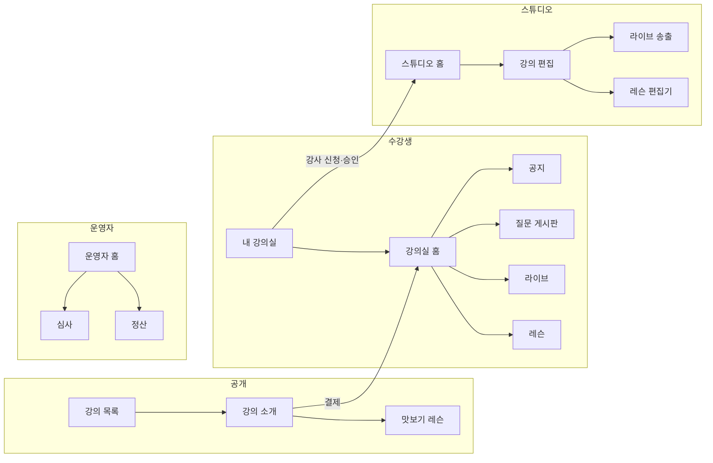
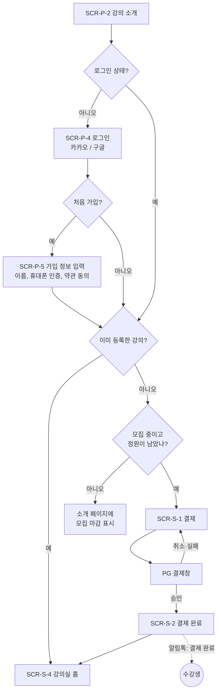
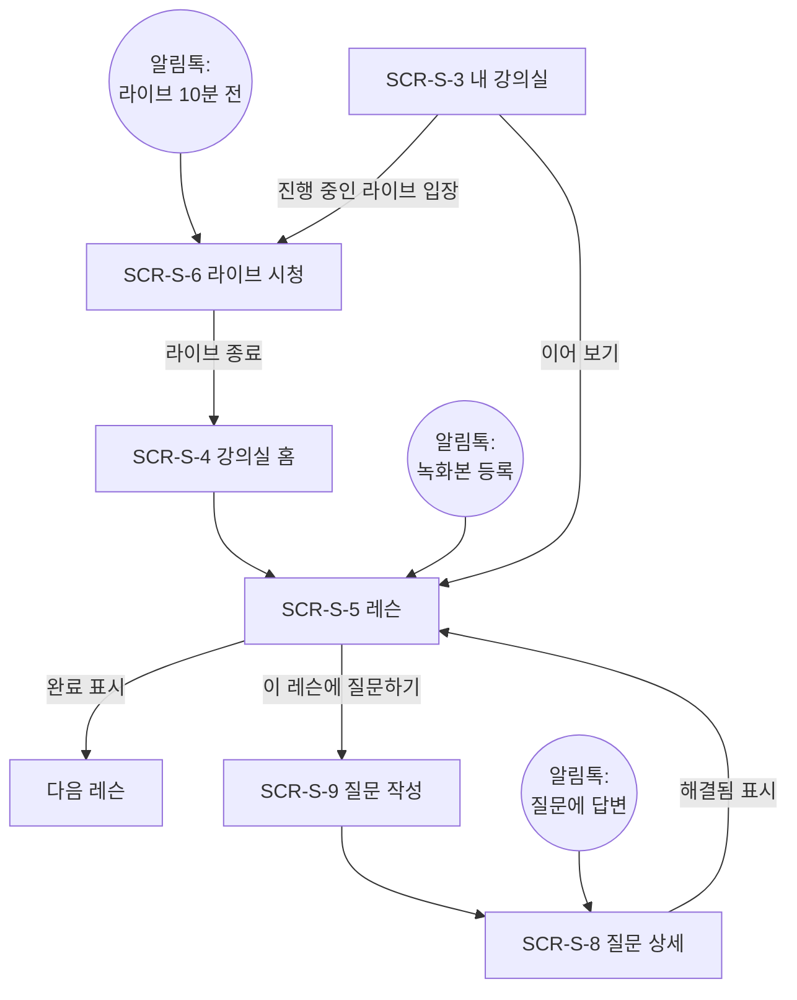
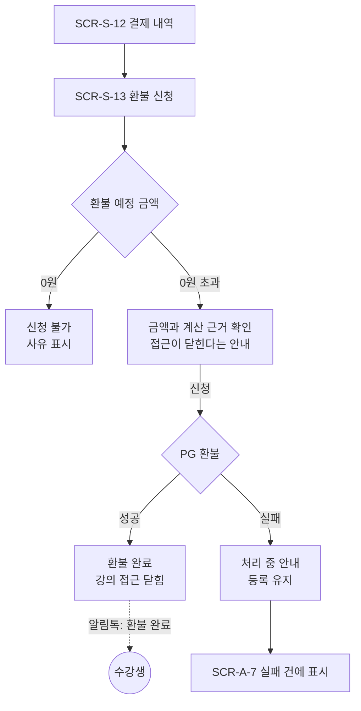
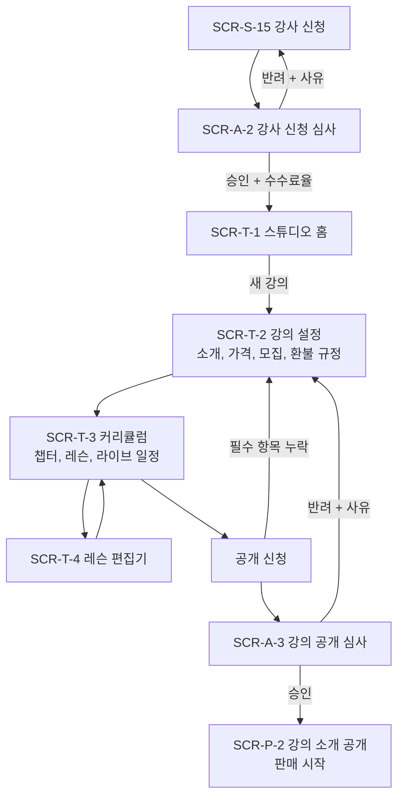
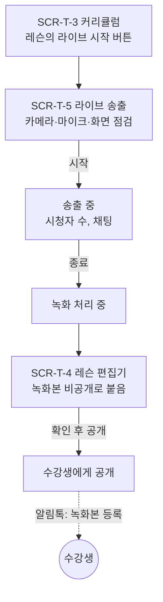
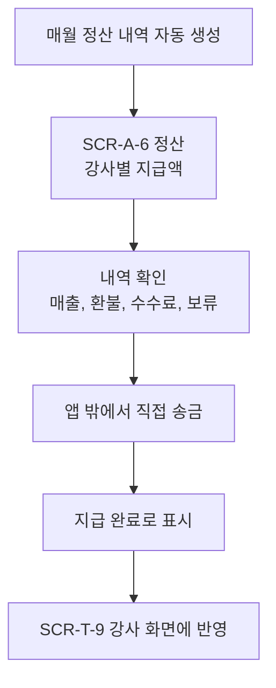

# DoClass 유저 플로우와 화면

> 초안 v1 · 2026-11-25
> 요구사항은 [1_product_requirements_document.md](1_product_requirements_document.md), 스토리는 [2_user_stories.md](2_user_stories.md)를 본다.

**읽는 법**

- 화면 ID는 `SCR-영역-번호`다. P 공개, S 수강생, T 강사 스튜디오, A 운영자.
- 경로는 가안이다. 구현하면서 바꿀 수 있지만 화면 ID는 유지한다.
- 이 문서는 어떤 화면이 있고 어떻게 이어지는지를 정한다. 시각 디자인(색, 글꼴, 간격)은 다루지 않는다.
- `(가정)`은 PRD에서 아직 가정으로 둔 값이다.

## 1. 전체 구조

앱은 네 영역으로 나뉜다. 한 계정이 여러 역할을 가지면 상단 메뉴에서 영역을 오간다.

| 영역 | 경로 | 들어올 수 있는 사람 |
|---|---|---|
| 공개 | `/`, `/courses/...` | 누구나 |
| 수강생 | `/my/...`, `/learn/...` | 로그인한 사용자. 강의실은 유효한 등록 필요 |
| 강사 스튜디오 | `/studio/...` | 승인된 강사 |
| 운영자 | `/admin/...` | 운영자 |

### 공통 요소

| 요소 | 내용 |
|---|---|
| 상단 메뉴 (로그인 전) | 로고, 강의 목록, 로그인 |
| 상단 메뉴 (로그인 후) | 로고, 강의 목록, 내 강의실, 알림, 프로필 메뉴(내 정보, 결제 내역, 스튜디오 또는 강사 신청, 운영자, 로그아웃) |
| 하단 | 사업자 정보, 이용약관, 개인정보처리방침, 환불 규정, 문의 |
| 접근 거부 | 로그인이 필요하면 로그인 후 원래 화면으로 돌아온다. 권한이 없으면 이유와 갈 곳(소개 페이지 등)을 보여 준다 |

## 2. 화면 목록

### 공개

| ID | 화면 | 경로 | 관련 스토리 |
|---|---|---|---|
| SCR-P-1 | 강의 목록 (홈) | `/` | US-V-1 |
| SCR-P-2 | 강의 소개 | `/courses/[slug]` | US-V-1, US-S-1 |
| SCR-P-3 | 맛보기 레슨 | `/courses/[slug]/preview/[lessonId]` | US-V-2 |
| SCR-P-4 | 로그인 | `/login` | US-V-3 |
| SCR-P-5 | 가입 정보 입력 | `/signup` | US-V-3 |
| SCR-P-6 | 약관·정책 | `/terms`, `/privacy`, `/refund-policy` | NFR-5 |

### 수강생

| ID | 화면 | 경로 | 관련 스토리 |
|---|---|---|---|
| SCR-S-1 | 결제 | `/checkout/[courseId]` | US-S-1 |
| SCR-S-2 | 결제 완료 | `/checkout/[courseId]/complete` | US-S-1 |
| SCR-S-3 | 내 강의실 (대시보드) | `/my` | US-S-3 |
| SCR-S-4 | 강의실 홈 | `/learn/[courseId]` | US-S-3, US-S-8 |
| SCR-S-5 | 레슨 | `/learn/[courseId]/lessons/[lessonId]` | US-S-4, US-S-7, US-S-8 |
| SCR-S-6 | 라이브 시청 | `/learn/[courseId]/live/[liveId]` | US-S-6, US-S-14 |
| SCR-S-7 | 질문 목록 | `/learn/[courseId]/questions` | US-S-10 |
| SCR-S-8 | 질문 상세 | `/learn/[courseId]/questions/[id]` | US-S-9 |
| SCR-S-9 | 질문 작성 | `/learn/[courseId]/questions/new` | US-S-9 |
| SCR-S-10 | 공지 | `/learn/[courseId]/notices` | US-S-11 |
| SCR-S-11 | 검색 결과 | `/learn/[courseId]/search` | US-S-5 |
| SCR-S-12 | 결제 내역 | `/my/payments` | US-S-2 |
| SCR-S-13 | 환불 신청 | `/my/payments/[id]/refund` | US-S-12 |
| SCR-S-14 | 내 정보·알림 설정 | `/my/settings` | US-S-15 |
| SCR-S-15 | 강사 신청 | `/my/instructor-application` | US-T-1 |

### 강사 스튜디오

| ID | 화면 | 경로 | 관련 스토리 |
|---|---|---|---|
| SCR-T-1 | 스튜디오 홈 | `/studio` | US-T-9, US-T-13 |
| SCR-T-2 | 강의 설정 | `/studio/courses/[id]/settings` | US-T-2, US-T-5 |
| SCR-T-3 | 커리큘럼 | `/studio/courses/[id]/curriculum` | US-T-3, US-T-6 |
| SCR-T-4 | 레슨 편집기 | `/studio/courses/[id]/lessons/[lessonId]` | US-T-4, US-T-8 |
| SCR-T-5 | 라이브 송출 | `/studio/courses/[id]/live/[liveId]` | US-T-7 |
| SCR-T-6 | 질문 관리 | `/studio/courses/[id]/questions` | US-T-9 |
| SCR-T-7 | 공지 관리 | `/studio/courses/[id]/notices` | US-T-10 |
| SCR-T-8 | 수강생 현황 | `/studio/courses/[id]/students` | US-T-11, US-T-12 |
| SCR-T-9 | 매출·정산 | `/studio/settlements` | US-T-13 |

### 운영자

| ID | 화면 | 경로 | 관련 스토리 |
|---|---|---|---|
| SCR-A-1 | 운영자 홈 | `/admin` | US-A-5 |
| SCR-A-2 | 강사 신청 심사 | `/admin/instructors` | US-A-1 |
| SCR-A-3 | 강의 공개 심사 | `/admin/courses` | US-A-2 |
| SCR-A-4 | 사용자 검색·상세 | `/admin/users`, `/admin/users/[id]` | US-A-3 |
| SCR-A-5 | 결제·환불 관리 | `/admin/payments` | US-A-3, US-A-4 |
| SCR-A-6 | 정산 | `/admin/settlements` | US-A-6 |
| SCR-A-7 | 실패 건 | `/admin/issues` | US-A-5 |
| SCR-A-8 | 변경 기록 | `/admin/audit` | US-A-7 |

## 3. 핵심 플로우

### 3.1 발견 → 가입 → 결제 → 강의실

- 결제 버튼에서 로그인으로 넘어간 경우, 가입이 끝나면 결제 화면으로 돌아온다.
- 결제 완료 화면은 서버가 PG 통지로 결제를 확정할 때까지 "확인 중"을 보여 준다. 확정되면 강의실 입장 버튼이 나온다.
- 브라우저가 닫혀 완료 화면을 못 봐도 등록은 만들어진다. 다시 들어오면 내 강의실에 강의가 보인다.

### 3.2 수업 듣기: 라이브 → 녹화본 → 질문

- 알림톡의 링크는 해당 화면으로 바로 간다. 로그인이 풀려 있으면 로그인 후 그 화면으로 돌아온다.
- 다른 기기에서 재생을 시작하면 이 기기의 라이브나 녹화본은 멈추고 "다른 기기에서 재생 중" 안내가 보인다.

### 3.3 환불

### 3.4 강사: 신청 → 강의 만들기 → 공개

### 3.5 강사: 라이브 → 녹화본 공개

### 3.6 운영자: 월 정산

## 4. 화면 상세

각 화면의 주요 요소, 할 수 있는 동작, 상태를 적는다. 모든 목록 화면은 비어 있을 때의 안내와 불러오는 중 표시를 가진다.

### 4.1 공개

**SCR-P-1 강의 목록**

- 요소: 강의 카드(대표 이미지, 제목, 강사, 개강일, 가격, 모집 상태)
- 동작: 카드를 누르면 강의 소개로 간다.
- 상태: 모집 중 / 모집 마감 / 진행 중. 공개된 강의가 없으면 안내 문구.

**SCR-P-2 강의 소개**

- 요소: 제목, 대표 이미지, 강사 소개, 강의 설명, 커리큘럼(챕터·레슨 제목, 맛보기 표시), 라이브 일정, 가격, 수강 기간(종료 후 6개월), 환불 규정, 결제 버튼
- 동작: 결제하기, 맛보기 레슨 보기
- 결제 버튼 상태

  | 조건 | 버튼 |
  |---|---|
  | 모집 중, 등록 안 함 | 결제하기 |
  | 이미 등록함 | 강의실 입장 |
  | 모집 기간 전 | 모집 시작일 안내 (비활성) |
  | 모집 기간 지남 | 모집 마감 (비활성) |
  | 정원이 참 | 정원 마감 (비활성) |

**SCR-P-3 맛보기 레슨**

- 요소: 레슨 본문, 강의 소개로 돌아가는 링크, 결제 버튼
- 맛보기가 아닌 레슨의 주소로 들어오면 강의 소개로 보낸다.

**SCR-P-4 로그인**

- 요소: 카카오 로그인 버튼, 구글 로그인 버튼
- 로그인 후에는 들어오려던 화면으로 돌아간다.

**SCR-P-5 가입 정보 입력**

- 요소: 이름, 휴대폰 번호와 인증번호 입력 (가정), 약관 동의(이용약관, 개인정보, 알림톡 수신)
- 필수 동의가 빠지면 가입 버튼이 눌리지 않는다.
- 소셜 로그인에서 받은 이름과 번호는 미리 채운다.

### 4.2 수강생

**SCR-S-1 결제**

- 요소: 강의 요약(제목, 일정, 수강 기간), 결제 금액, 환불 규정 요약, 결제 수단 선택, 구매 조건 동의, 결제하기 버튼
- 동작: 결제하기를 누르면 PG 결제창이 뜬다.
- 상태: 결제 실패나 취소 시 이 화면에 사유를 보여 주고 다시 시도할 수 있다.

**SCR-S-2 결제 완료**

- 상태: 확인 중 → 완료(강의실 입장 버튼, 영수증 링크) / 실패(사유, 다시 결제)

**SCR-S-3 내 강의실**

- 요소: 다음 라이브(날짜, 시각, 진행 중이면 입장 버튼), 등록한 강의 카드(진도율, 만료일, 이어 보기), 만료된 강의(구분해서 표시)
- 상태: 등록한 강의가 없으면 강의 목록으로 가는 안내.

**SCR-S-4 강의실 홈**

- 요소: 강의 제목, 진도율, 다음 라이브, 최근 공지, 목차(챕터 → 레슨, 완료 표시, 잠금 표시, 라이브 일정), 탭(목차, 질문, 공지), 검색창
- 레슨 상태

  | 상태 | 표시 |
  |---|---|
  | 공개됨 | 열 수 있음 |
  | 공개 시각 전 | 제목과 공개 예정일, 잠금 |
  | 라이브 예정 | 일정 표시 |
  | 라이브 진행 중 | 입장 버튼 |
  | 녹화본 처리 중 | 준비 중 표시 |
  | 완료 | 체크 표시 |

**SCR-S-5 레슨**

- 요소: 영상 플레이어(있을 때), 본문, 코드 블록의 복사 버튼, 첨부 파일, 완료 표시 버튼, 이전·다음 레슨, 이 레슨의 질문 목록, 질문하기 버튼, 접을 수 있는 목차
- 영상 플레이어: 재생 속도, 전체 화면, 자막, 이어 보기, 시청자 식별 워터마크
- 상태: 다른 기기에서 재생 중이면 플레이어가 멈추고 안내와 "여기서 보기" 버튼을 보여 준다.
- 모바일: 플레이어가 위에 고정되고 본문이 아래로 흐른다. 목차는 서랍으로 연다.

**SCR-S-6 라이브 시청**

- 요소: 라이브 화면(워터마크), 채팅, 시청자 수, 이 레슨의 자료로 가는 링크
- 상태

  | 상태 | 표시 |
  |---|---|
  | 시작 전 | 시작 시각과 남은 시간, 대기 안내 |
  | 진행 중 | 화면과 채팅 |
  | 일시 끊김 | 다시 연결 중 안내 |
  | 종료 | 종료 안내, 녹화본이 곧 올라온다는 안내, 레슨으로 가기 |
  | 채팅 차단됨 | 입력창 비활성과 안내 |
  | 다른 기기에서 재생 중 | 화면 멈춤과 "여기서 보기" 버튼 |

- 모바일: 화면이 위, 채팅이 아래. 가로로 돌리면 화면만 크게 본다.

**SCR-S-7 질문 목록**

- 요소: 질문 목록(제목, 레슨, 작성자, 답변 수, 해결 여부, 강사 답변 표시), 검색, 필터(전체, 내 질문, 미해결, 레슨별), 질문하기 버튼
- 이전 기수 질문이 공개된 강의는 기수 표시가 붙는다.

**SCR-S-8 질문 상세**

- 요소: 질문 본문(코드 블록, 이미지), 연결된 레슨 링크, 답변 목록(강사 답변 구분), 답변 작성란
- 동작: 답변 달기, 해결됨 표시(질문자), 내 글 수정·삭제

**SCR-S-9 질문 작성**

- 요소: 제목, 레슨 선택(레슨에서 들어오면 미리 선택), 본문 편집기(코드 블록, 이미지 첨부), 미리보기
- 작성 중 나가려 하면 확인을 묻는다.

**SCR-S-10 공지**

- 요소: 공지 목록(제목, 게시일), 공지 본문

**SCR-S-11 검색 결과**

- 요소: 검색어, 결과 목록(레슨 제목, 일치하는 부분 미리보기). 질문도 함께 검색한다. (가정)

**SCR-S-12 결제 내역**

- 요소: 결제 목록(강의, 금액, 결제일, 상태), 영수증 보기, 환불 신청 버튼
- 환불할 수 없는 결제에는 버튼 대신 사유를 보여 준다.

**SCR-S-13 환불 신청**

- 요소: 결제 정보, 적용되는 환불 규정, 계산 근거(진행된 수업 수 또는 개강 후 지난 일수), 환불 예정 금액, 접근이 닫힌다는 경고, 신청 버튼
- 상태: 신청 가능 / 신청 불가(사유) / 처리 중 / 완료

**SCR-S-14 내 정보·알림 설정**

- 요소: 이름, 이메일(읽기 전용), 휴대폰 번호 변경(재인증), 연결된 로그인 계정, 알림 종류별 수신 스위치(결제·환불은 끌 수 없음), 회원 탈퇴

**SCR-S-15 강사 신청**

- 요소: 소개, 경력, 정산 정보(예금주, 은행, 계좌번호, 사업자 여부), 신청 버튼
- 상태: 신청 전 / 심사 중 / 반려됨(사유, 다시 신청) / 승인됨(스튜디오로 가기)

### 4.3 강사 스튜디오

스튜디오 화면은 왼쪽에 강의별 메뉴(설정, 커리큘럼, 질문, 공지, 수강생)를 둔다. 데스크톱 사용을 기준으로 한다.

**SCR-T-1 스튜디오 홈**

- 요소: 내 강의 목록(상태, 수강생 수, 매출), 할 일(답변 없는 질문 수, 다가오는 라이브, 공개 대기 녹화본), 새 강의 버튼, 이전 기수 복제 버튼
- 강의 상태: 초안 / 심사 중 / 반려됨 / 판매 중 / 모집 마감 / 종료 / 판매 중지

**SCR-T-2 강의 설정**

- 요소: 제목, 주소(slug), 대표 이미지, 소개, 가격, 모집 기간, 정원, 종료일, 환불 규정 방식(세 가지 중 선택, 기간 내 전액은 일수 입력), 소개 페이지 미리보기, 공개 신청 버튼
- 공개 신청 시 빠진 필수 항목을 목록으로 보여 준다.
- 결제가 일어난 뒤 가격이나 환불 규정을 바꾸면 "기존 수강생에게는 적용되지 않는다"는 안내를 보여 준다.

**SCR-T-3 커리큘럼**

- 요소: 챕터와 레슨 목록(끌어서 순서 변경), 레슨별 상태(초안, 예약, 공개), 맛보기 지정, 라이브 일정, 라이브 시작 버튼
- 동작: 챕터·레슨 추가, 이름 변경, 삭제, 순서 변경, 라이브 일정 설정
- 진도나 질문이 있는 레슨을 삭제하려 하면 경고한다.

**SCR-T-4 레슨 편집기**

- 요소: 제목, 마크다운 편집기와 미리보기, 이미지 업로드, 첨부 파일, 영상(업로드 또는 라이브 녹화본, 처리 상태, 공개 여부), 공개 설정(초안, 지금 공개, 예약), 수강생 화면으로 보기
- 영상 상태: 없음 / 업로드 중 / 처리 중 / 비공개 준비됨 / 공개됨 / 실패
- 저장하지 않고 나가려 하면 확인을 묻는다.

**SCR-T-5 라이브 송출**

- 요소: 송출 미리보기, 카메라·마이크·화면 공유 선택과 켜고 끄기, 시작·종료 버튼, 시청자 수, 채팅(메시지 삭제, 채팅 차단), 송출 상태 표시
- 상태: 점검 중 / 송출 중 / 연결 불안정 / 종료(녹화 처리 중)
- 종료 버튼은 확인을 한 번 더 묻는다.
- 브라우저가 카메라·마이크 권한을 막고 있으면 푸는 방법을 안내한다.

**SCR-T-6 질문 관리**

- 요소: 질문 목록, 필터(강사 답변 없음, 미해결, 레슨별), 답변 작성, 글 삭제, 이전 기수 질문 공개 설정

**SCR-T-7 공지 관리**

- 요소: 공지 목록, 공지 작성(제목, 본문), 게시 버튼
- 게시 전에 "수강생 N명에게 알림톡 안내가 나간다"는 확인을 보여 준다.

**SCR-T-8 수강생 현황**

- 요소: 수강생 목록(이름, 가려진 휴대폰 번호, 등록일, 진도율, 만료일, 상태), 레슨별 완료율, CSV 내려받기, 수강 기간 연장
- 등록 상태: 유효 / 환불 / 만료

**SCR-T-9 매출·정산**

- 요소: 내 수수료율, 강의별 매출 요약(결제 건수, 매출, 환불), 월별 정산 내역(매출, 환불, PG 수수료, 플랫폼 수수료, 지급액, 상태), 내역 내려받기
- 정산 상태: 예정 / 보류 / 지급 완료

### 4.4 운영자

**SCR-A-1 운영자 홈**

- 요소: 처리할 일(강사 신청 수, 강의 심사 수, 실패 건 수, 이번 달 정산), 최근 결제와 환불

**SCR-A-2 강사 신청 심사**

- 요소: 신청 목록(대기, 승인, 반려), 신청 내용, 수수료율 입력, 승인 버튼, 반려 버튼과 사유 입력
- 승인된 강사의 수수료율을 나중에 바꿀 수 있다. 바꾼 뒤의 결제부터 적용된다는 안내를 보여 준다.

**SCR-A-3 강의 공개 심사**

- 요소: 심사 대기 목록, 수강생 화면으로 미리보기(소개 페이지, 레슨), 승인, 반려와 사유, 판매 중인 강의의 판매 중지·숨김

**SCR-A-4 사용자 검색·상세**

- 요소: 검색(이름, 이메일, 휴대폰 번호), 사용자 상세(역할, 등록 목록, 결제·환불, 알림 발송 기록)
- 동작: 등록 직접 만들기, 등록 끝내기, 수강 기간 연장

**SCR-A-5 결제·환불 관리**

- 요소: 결제 목록과 필터(강의, 기간, 상태), 결제 상세(PG 거래 정보, 적용된 환불 규정), 수동 환불(금액, 사유)
- 수동 환불은 결제 금액을 넘을 수 없고 사유가 없으면 진행되지 않는다.

**SCR-A-6 정산**

- 요소: 월 선택, 강사별 정산 내역(매출, 환불, PG 수수료, 플랫폼 수수료, 보류액, 지급액), 정산 계좌 정보, 지급 완료 표시, 내려받기

**SCR-A-7 실패 건**

- 요소: 실패 목록(환불 실패, 결제됐는데 등록 없음, 알림 발송 실패), 종류별 필터, 다시 시도, 처리 완료 표시
- 알림톡이 문자로 대체된 건은 따로 표시한다.

**SCR-A-8 변경 기록**

- 요소: 기록 목록(누가, 언제, 무엇을, 사유), 필터(종류, 사람, 기간). 읽기 전용.

## 5. 알림과 도착 화면

알림톡의 링크를 눌렀을 때 도착하는 화면이다.

| 알림 | 도착 화면 |
|---|---|
| 결제 완료 | SCR-S-4 강의실 홈 |
| 개강 안내 | SCR-S-4 강의실 홈 |
| 라이브 시작 | SCR-S-6 라이브 시청 |
| 녹화본 등록 | SCR-S-5 레슨 |
| 새 공지 | SCR-S-10 공지 |
| 질문에 답변 | SCR-S-8 질문 상세 |
| 새 질문 (강사) | SCR-T-6 질문 관리 |
| 수강 기간 만료 임박 | SCR-S-4 강의실 홈 |
| 환불 완료 | SCR-S-12 결제 내역 |
| 강사 신청 결과 | SCR-S-15 강사 신청 |
| 강의 심사 결과 | SCR-T-2 강의 설정 |

## 6. 접근이 막혔을 때

| 상황 | 보여 주는 것 |
|---|---|
| 로그인하지 않고 수강생·스튜디오·운영자 화면에 접근 | 로그인으로 보내고, 로그인 후 원래 화면으로 돌아온다 |
| 등록하지 않은 강의의 강의실에 접근 | 강의 소개로 보낸다 |
| 환불한 강의의 강의실에 접근 | 환불된 강의라는 안내와 결제 내역 링크 |
| 수강 기간이 끝난 강의의 강의실에 접근 | 만료 안내와 만료일. 결제 내역은 볼 수 있다는 안내 |
| 공개 시각 전의 레슨에 접근 | 공개 예정일 안내 |
| 강사가 아닌데 스튜디오에 접근 | 강사 신청 화면으로 보낸다 |
| 다른 강사의 강의 관리 화면에 접근 | 찾을 수 없음 |
| 운영자가 아닌데 운영자 화면에 접근 | 찾을 수 없음 |

## 7. 열린 질문

- [ ] 강의실 검색이 질문 게시판까지 포함해야 하는가? (SCR-S-11)
- [ ] 강사 스튜디오를 모바일에서도 쓸 수 있어야 하는가? 지금은 데스크톱 기준이다.
- [ ] 강사 신청 때 받을 정산 정보의 범위는? (개인 / 사업자, 필요한 서류)
- [ ] 앱 안 알림(상단 메뉴의 알림 목록)에 무엇을 보여 줄 것인가? 알림톡과 같은 목록인가?
- [ ] 강의 주소(slug)는 강사가 정하는가, 자동으로 만드는가?
